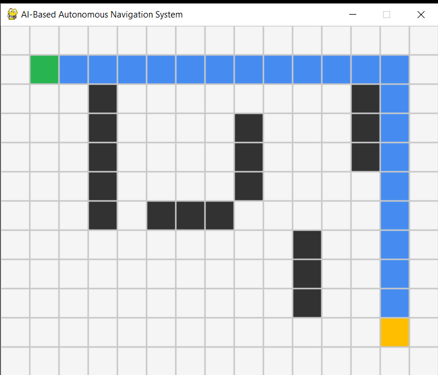
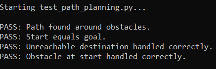

# AI-Based Autonomous Navigation System

A Python-based autonomous navigation prototype that simulates a robot navigating a 2D grid environment, plans a path around obstacles using the A* algorithm, and demonstrates camera-based object detection using OpenCV and pretrained YOLO.

## Features

- 2D robot navigation simulation using Pygame
- A* path-planning algorithm
- Simulated obstacle perception
- Webcam capture using OpenCV
- Real-time object detection using pretrained YOLO
- Four path-planning tests

## Technologies

- Python 3.11
- Pygame
- NumPy
- Matplotlib
- OpenCV
- Ultralytics YOLO

## Project Structure

```text
AI-Autonomous-Navigation-System/
├── docs/
├── images/
│   ├── simulation_environment.png
│   └── test_results.png
├── outputs/
├── simulation/
│   └── environment.py
├── src/
│   ├── camera_capture.py
│   ├── object_detection.py
│   ├── path_planning.py
│   └── perception.py
├── tests/
├── main.py
├── requirements.txt
└── test_path_planning.py
```

## Setup

Use Python 3.11 and create a virtual environment.

```bash
python -m venv .venv
```

Activate it on Windows:

```bat
.venv\Scripts\activate
```

Install the dependencies:

```bash
pip install -r requirements.txt
```

## Run the Project

Launch the main menu:

```bash
python main.py
```

Choose from the menu:

1. Run the Pygame navigation simulation.
2. Open the webcam camera feed.
3. Run YOLO object detection.
4. Run path-planning tests.
5. Exit.

You can also run the tests directly:

```bash
python test_path_planning.py
```

## Current Test Results

All four path-planning tests passed:

- Path found around obstacles.
- Start equals goal.
- Unreachable destination handled correctly.
- Obstacle at start handled correctly.

The simulation successfully reached its destination in 21 moves during testing.

## Screenshots

### Pygame Navigation Simulation



### Path-Planning Test Results



## Current Limitations

- The simulation uses predefined grid obstacles.
- The webcam and YOLO object-detection modules operate separately from the navigation planner.
- Camera detections do not currently update the robot's route.
- The system is a software prototype; physical robot deployment is not implemented.

## Future Improvements

- Detect dynamic obstacles and update routes automatically.
- Integrate camera detections with path planning.
- Add lane detection and richer simulated environments.
- Explore ROS 2 and SLAM.
- Add more navigation tests and performance visualizations.

## Author

**Jatin Gujarathi**

- GitHub: [@jatingujju](https://github.com/jatingujju)
- LinkedIn: [Jatin Gujarathi](https://www.linkedin.com/in/jatin-gujarathi-bb16a7221/)

